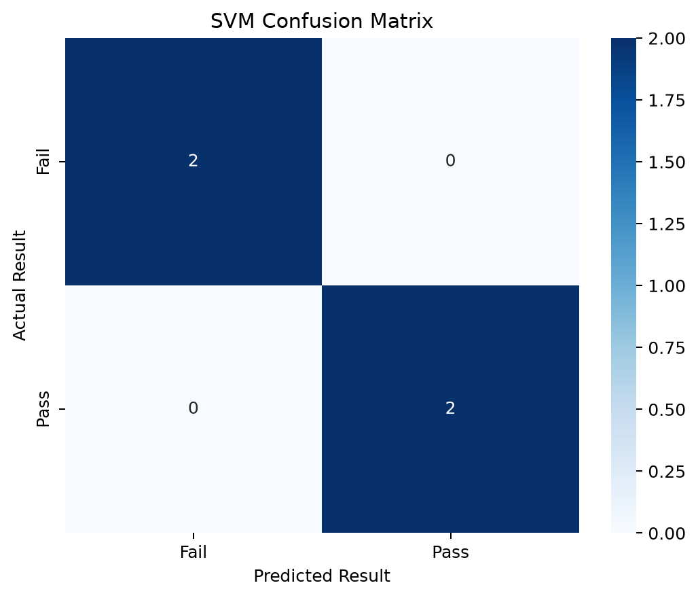
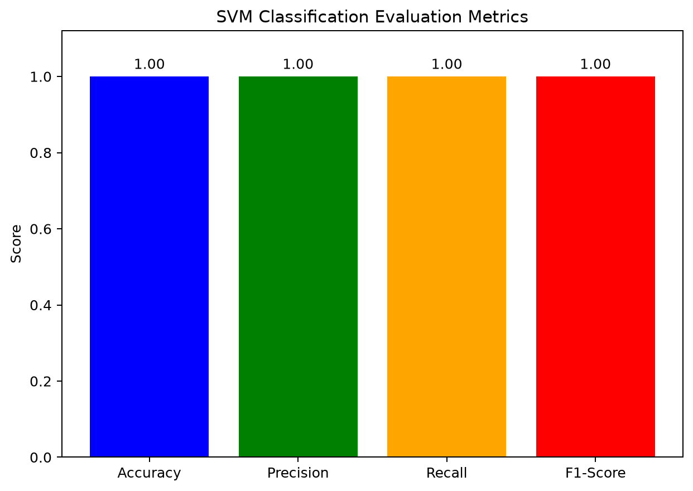

$111259A185 - SVM Classification

[Back to experiments](../README.md)

[Python source](11259A185_svm_classification.py) | [Dataset](data.csv) | [Text output](output.txt)

## Code

```python
import pandas as pd
import matplotlib.pyplot as plt
import seaborn as sns

from sklearn.model_selection import train_test_split
from sklearn.svm import SVC
from sklearn.metrics import (
    accuracy_score,
    confusion_matrix,
    classification_report
)

# Load dataset
data = pd.read_csv("data.csv")

# Input features
X = data[['Hours_Studied', 'Attendance', 'Assignments']]

# Target variable
y = data['Result']

# Split dataset
X_train, X_test, y_train, y_test = train_test_split(
    X, y, test_size=0.2, random_state=42
)

# Create SVM model
model = SVC(kernel='linear')

# Train model
model.fit(X_train, y_train)

# Predict
y_pred = model.predict(X_test)

# Evaluation Metrics
accuracy = accuracy_score(y_test, y_pred)

print("Accuracy:", accuracy)

print("\nConfusion Matrix:")
cm = confusion_matrix(y_test, y_pred)
print(cm)

print("\nClassification Report:")
print(classification_report(y_test, y_pred))


import pandas as pd
import matplotlib.pyplot as plt
import seaborn as sns

from sklearn.model_selection import train_test_split
from sklearn.svm import SVC
from sklearn.metrics import (
    accuracy_score,
    confusion_matrix,
    classification_report
)

# Load dataset
data = pd.read_csv("data.csv")

# Input features
X = data[['Hours_Studied', 'Attendance', 'Assignments']]

# Target variable
y = data['Result']

# Split dataset
X_train, X_test, y_train, y_test = train_test_split(
    X, y, test_size=0.2, random_state=42
)

# Create SVM model
model = SVC(kernel='linear')

# Train model
model.fit(X_train, y_train)

# Predict
y_pred = model.predict(X_test)

# Evaluation Metrics
accuracy = accuracy_score(y_test, y_pred)

print("Accuracy:", accuracy)

print("\nConfusion Matrix:")
cm = confusion_matrix(y_test, y_pred)
print(cm)

print("\nClassification Report:")
print(classification_report(y_test, y_pred))


# -----------------------------
$111259A185 - Confusion Matrix Graph
# -----------------------------
plt.figure(figsize=(6, 5))

sns.heatmap(
    cm,
    annot=True,
    fmt='d',
    cmap='Blues',
    xticklabels=model.classes_,
    yticklabels=model.classes_
)

plt.xlabel("Predicted Result")
plt.ylabel("Actual Result")
plt.title("SVM Confusion Matrix")
plt.tight_layout()
plt.savefig("svm_confusion_matrix.png", dpi=180, bbox_inches="tight")
plt.close()


# -----------------------------
$111259A185 - Evaluation Metrics Graph
# -----------------------------
report = classification_report(
    y_test,
    y_pred,
    output_dict=True
)

metrics = {
    "Accuracy": accuracy,
    "Precision": report["weighted avg"]["precision"],
    "Recall": report["weighted avg"]["recall"],
    "F1-Score": report["weighted avg"]["f1-score"]
}

plt.figure(figsize=(7, 5))

plt.bar(
    metrics.keys(),
    metrics.values(),
    color=['blue', 'green', 'orange', 'red']
)

plt.ylim(0, 1.12)
plt.ylabel("Score")
plt.title("SVM Classification Evaluation Metrics")

for i, value in enumerate(metrics.values()):
    plt.text(i, value + 0.02, f"{value:.2f}", ha='center')

plt.tight_layout()
plt.savefig("svm_evaluation_metrics.png", dpi=180, bbox_inches="tight")
plt.close()
```

## Output

```text
Accuracy: 1.0

Confusion Matrix:
[[2 0]
 [0 2]]

Classification Report:
              precision    recall  f1-score   support

        Fail       1.00      1.00      1.00         2
        Pass       1.00      1.00      1.00         2

    accuracy                           1.00         4
   macro avg       1.00      1.00      1.00         4
weighted avg       1.00      1.00      1.00         4
```

## Graphs





These metrics describe the four held-out test records in the supplied dataset.

## Run

From this experiment folder, run `python 11259A185_svm_classification.py`. Both PNG graphs are saved in this folder.

